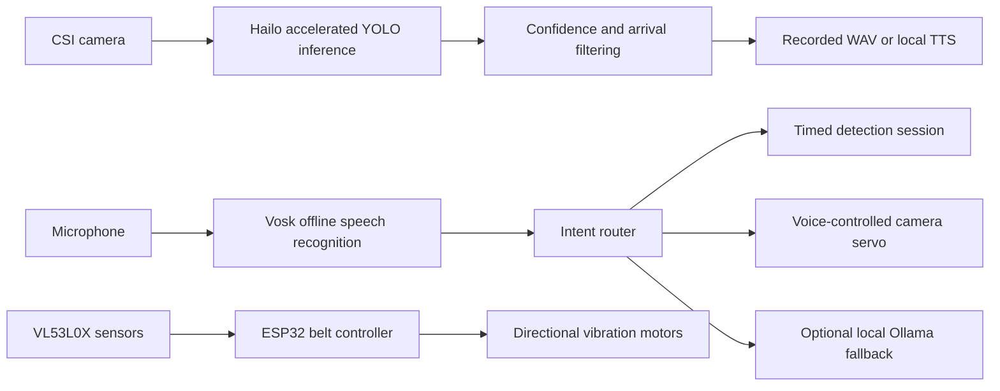
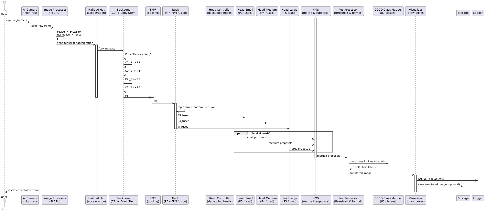
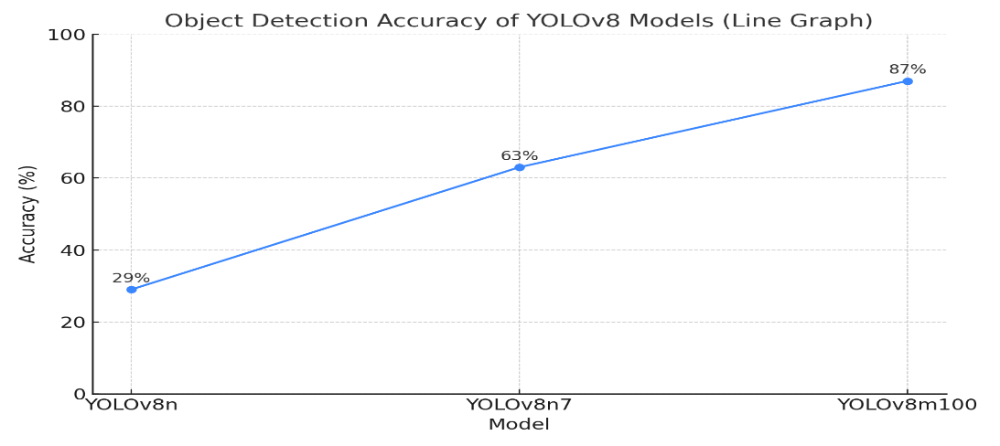
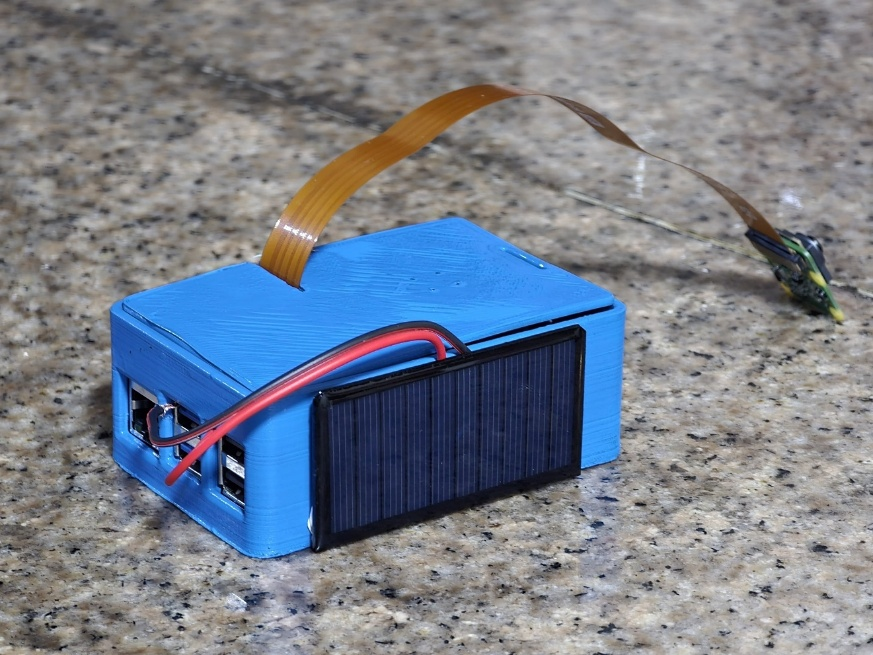
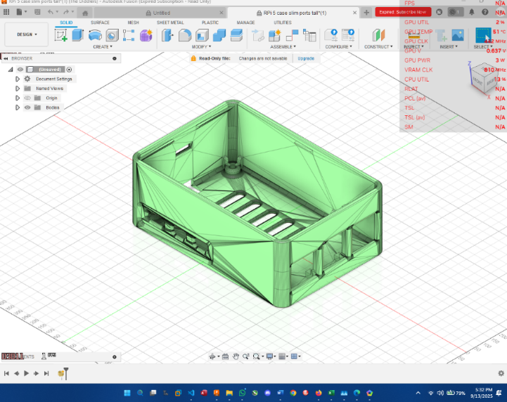

<div align="center">

# JØ7 Vireo

### Offline edge-AI navigation assistance for blind and visually impaired users

[](LICENSE)
[](pyproject.toml)
[](docs/HARDWARE.md)
[](docs/INSTALLATION.md)
[](docs/SAFETY.md)

**Real-time object identification, offline voice interaction, directional haptics and a voice-controlled camera—designed around affordability, privacy and low-connectivity environments.**

[Quick start](#quick-start) · [Architecture](docs/ARCHITECTURE.md) · [Hardware](docs/HARDWARE.md) · [Model card](docs/MODEL_CARD.md) · [Safety](docs/SAFETY.md)

</div>

---

## Why VIREO exists

Many advanced assistive-vision products are expensive or depend on continuous internet access. JØ7 VIREO explores a different design point: **local inference on affordable embedded hardware**, with immediate audio and haptic feedback and no cloud dependency during normal operation.

The project was created by **Jivesh Ramnath** and developed as a school-level computer-science research and engineering project in South Africa. Public Eskom Expo coverage describes VIREO as a low-cost AI-powered navigation device that uses real-time object identification and distance awareness to help blind and visually impaired users perceive their surroundings.

> **Scope:** VIREO is an experimental research prototype. It is not a certified medical device and must not be used as the only mobility or safety aid.

## Recognition

The project's public record includes:

- **Best Innovation**, 2025 North Coast Regional Science Fair — [Eskom Expo for Young Scientists](https://exposcience.co.za/young-scientists-showcase-innovations-at-north-coast-regional-science-fair/)
- **Silver medal**, Computing & Data Sciences, 45th Eskom Expo International Science Fair 2025 — [official results](https://exposcience.co.za/young-innovators-shine-at-the-45th-eskom-expo-international-science-fair/)
- **Silver medal**, Computer Science, IRIS Global Symposium 2026 in New Delhi — [Eskom Expo announcement](https://exposcience.co.za/sa-young-scientists-awarded-medals-at-iris-global-symposium-in-india/)

Additional public project coverage is collected in [docs/RECOGNITION.md](docs/RECOGNITION.md).

## System overview

VIREO is split into two largely independent systems:

1. **Head-mounted perception unit**
   - Raspberry Pi 5
   - Hailo AI accelerator running a compiled YOLOv8m HEF model
   - CSI camera input
   - Offline object announcements
   - Vosk speech recognition
   - Local TTS through Coqui or eSpeak
   - Optional Ollama fallback
   - Voice-controlled SG90 camera rotation

2. **Directional haptic belt**
   - ESP32 controller
   - Three VL53L0X time-of-flight sensors
   - Left, centre and right vibration zones
   - Independent operation if the vision unit fails





## Key capabilities

| Capability | Current open-source implementation |
|---|---|
| Object detection | Hailo/GStreamer callback using the included `yolov8m.hef` |
| Offline speech recognition | Vosk small US-English model |
| Object announcements | Personal WAV files when present; eSpeak fallback otherwise |
| Voice assistant | Fixed offline intents plus optional Ollama fallback |
| Camera movement | Spoken relative or absolute SG90 servo commands |
| Haptic proximity | ESP32 + three VL53L0X sensors + three motor-driver outputs |
| Cloud dependency | None during normal operation after models are installed |
| Fail-safe positioning | Vision and haptic subsystems can operate independently |

## Repository layout

```text
J07-VIREO/
├── src/vireo/                    Python application package
├── firmware/                     ESP32 belt and RP2040 prototype firmware
├── scripts/                      Installation, launch and verification scripts
├── models/yolov8m.hef            Compiled Hailo deployment model
├── assets/images/                Project photographs, CAD and result figures
├── docs/                         Build, architecture, model, safety and research docs
├── tests/                        Hardware-independent unit tests
├── archive/original-code/        Preserved prototype source for provenance
└── .github/                      CI and contribution templates
```

## Quick start

### 1. Target environment

The open-source setup targets a **64-bit Debian-based Raspberry Pi 5 installation**. The historical reports mention both Ubuntu and Raspberry Pi OS across development iterations; use the operating system version supported by your installed Hailo Raspberry Pi stack.

Required hardware:

- Raspberry Pi 5
- Compatible Hailo AI HAT / accelerator
- Raspberry Pi CSI camera
- Microphone and audio output
- Optional SG90 servo on GPIO 17
- Optional ESP32 haptic belt

### 2. Clone and install

```bash
git clone https://github.com/Jivyzn/JO7-Vireo.git
cd J07-VIREO
chmod +x scripts/*.sh
./scripts/install_pi.sh
```

Install Hailo's official Raspberry Pi 5 software and examples separately, then download the Vosk model:

```bash
./scripts/download_vosk_model.sh
./scripts/verify_environment.sh
```

### 3. Configure

```bash
cp .env.example .env
nano .env
set -a
source .env
set +a
```

The most important values are:

```bash
VIREO_HEF_MODEL=./models/yolov8m.hef
VIREO_VOSK_MODEL=./models/vosk-model-small-en-us-0.15
HAILO_EXAMPLES_DIR=~/hailo-rpi5-examples
```

### 4. Run object detection

```bash
./scripts/run_object_detection.sh
```

The launcher activates Hailo's environment and stops the detection session cleanly after 15 seconds by default. Override the duration with:

```bash
VIREO_DETECTION_SECONDS=30 ./scripts/run_object_detection.sh
```

### 5. Run the voice assistant

```bash
./scripts/run_assistant.sh
```

Example commands:

```text
“What objects are around me?”
“What time is it?”
“Where am I?”
“Repeat that.”
“Stop.”
```

### 6. Run voice-controlled servo movement

```bash
./scripts/run_servo.sh
```

Example commands:

```text
“Thirty left”
“Twenty right”
“Centre”
“One hundred and twenty”
“Exit”
```

See [docs/INSTALLATION.md](docs/INSTALLATION.md) for the full setup and [docs/TROUBLESHOOTING.md](docs/TROUBLESHOOTING.md) for common Hailo, audio and GPIO issues.

## Model and reported performance

The included binary is:

```text
models/yolov8m.hef
SHA-256: 53a92d7db2e43bad67e4426a848767e91981c166f90f9e775caeb5898433a852
Size: 30,526,867 bytes
```

The project reports the following controlled-test progression:

| Model iteration | Reported controlled detection rate |
|---|---:|
| YOLOv8n prototype | 29% |
| YOLOv8n7 intermediate | 63% |
| YOLOv8m final | 87% |

Additional reported system measurements:

| Metric | Reported result |
|---|---:|
| Mean detection-to-feedback latency | ~150 ms |
| Inference throughput | ~30–65 FPS |
| Head-unit battery life | ~4 hours |
| Haptic-belt continuous runtime | ~1.5 hours |
| Raspberry Pi peak temperature at ~25 °C ambient | ~54 °C after cooling improvements |

These are **author-reported prototype results**, not independently reproduced benchmarks. The source reports also differ on whether the controlled detection protocol contained 80 or 100 target instances. For that reason, the percentages are not presented as COCO mAP or as a clinical safety claim. Read [docs/PERFORMANCE.md](docs/PERFORMANCE.md) before comparing them with other systems.



## Hardware development





The prototype combined edge-compute hardware, a custom enclosure, reused battery cells, cooling modifications and a hand-built voice-controlled camera mechanism. Reproducing the battery system requires specialist electrical knowledge; the repository strongly recommends certified cells and a professionally built protected pack instead of reclaimed vape cells.

Full hardware information and pin mappings are in [docs/HARDWARE.md](docs/HARDWARE.md).

## Safety and limitations

Do not use VIREO as a replacement for:

- a white cane or guide dog;
- formal orientation and mobility training;
- human assistance in unfamiliar or dangerous environments;
- certified collision-avoidance or medical equipment.

Known limitations include low-light performance, glare, reflective backgrounds, very close-range visual ambiguity, class imbalance, speech-recognition errors, audio latency and prototype battery variability. Read the complete [safety notice](docs/SAFETY.md).

## Development and testing

Hardware-independent checks can run on an ordinary computer:

```bash
python3 -m venv .venv
.venv/bin/pip install -e . -r requirements-dev.txt
.venv/bin/ruff check src tests
.venv/bin/pytest -q
```

CI verifies syntax, style and pure state/parsing logic. It cannot validate the CSI camera, Hailo accelerator, microphone, servo timing, LiDAR sensors or motor electronics.

## Documentation

- [Architecture](docs/ARCHITECTURE.md)
- [Installation](docs/INSTALLATION.md)
- [Hardware and wiring](docs/HARDWARE.md)
- [Model card](docs/MODEL_CARD.md)
- [Performance and evidence](docs/PERFORMANCE.md)
- [Dataset statement](docs/DATASET.md)
- [Safety and ethical use](docs/SAFETY.md)
- [Troubleshooting](docs/TROUBLESHOOTING.md)
- [Roadmap](ROADMAP.md)
- [Public recognition](docs/RECOGNITION.md)
- [Project history](docs/PROJECT_HISTORY.md)
- [2026 research report](docs/reports/JØ7_Vireo_Research_Report_2026.docx)
- [GitHub deployment](docs/GITHUB_DEPLOYMENT.md)
- [Release validation](docs/VALIDATION.md)

## Licence

The repository is released under **AGPL-3.0-or-later**. This conservative choice aligns the open-source release with the AGPL-licensed Ultralytics training ecosystem described by the project. Hailo-derived portions retain their upstream MIT attribution, and every external dependency keeps its own licence. See [LICENSE](LICENSE) and [THIRD_PARTY_NOTICES.md](THIRD_PARTY_NOTICES.md).

The included model and third-party runtime components may have additional terms. This repository does not provide legal advice or grant rights it does not own.

## Citation

```bibtex
@software{ramnath_2026_vireo,
  author  = {Jivesh Ramnath},
  title   = {JØ7 VIREO: A Low-Cost Offline Edge-AI Assistive Navigation Prototype},
  year    = {2026},
  version = {1.0.0}
}
```

## Author

**Jivesh Ramnath** — project creator, system designer and developer.

Contributions are welcome, especially around reproducible Hailo deployment, safer power design, multilingual offline speech, accessible user testing and robust sensor fusion.
