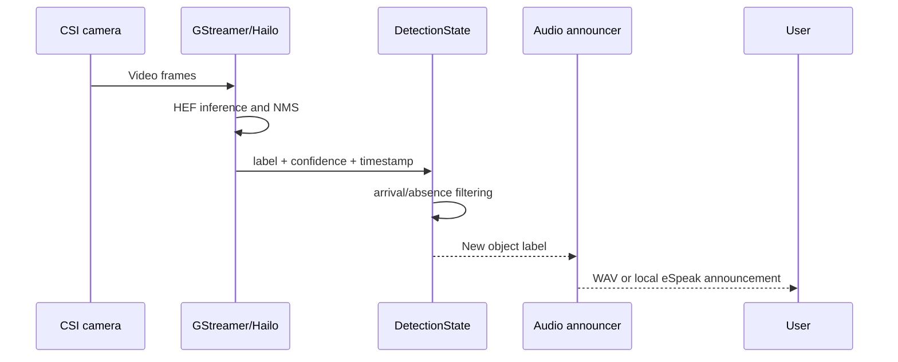
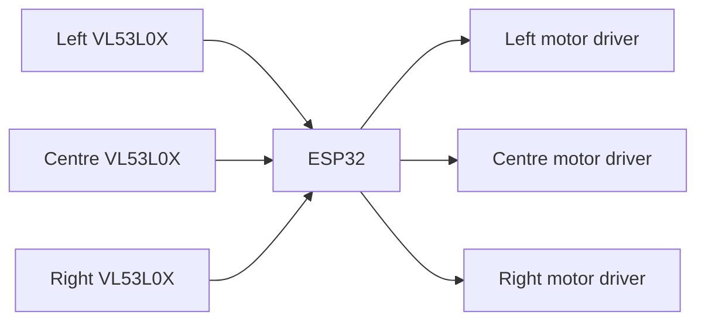

# Architecture

JØ7 VIREO is intentionally modular. The head-mounted perception unit and the haptic belt can continue operating independently, reducing the chance that one software or hardware fault removes every feedback channel.

## Head-mounted unit

### Perception layer

`src/vireo/camera_feed.py` uses Hailo's Raspberry Pi application infrastructure to receive detections from the compiled HEF model. Detections below the configured confidence threshold are ignored.

### Temporal filtering

`DetectionState` records when each class label was last seen. A label is announced when it appears as a new arrival. It must disappear for the configured absence interval before it can become eligible for another announcement.

The announcement worker has a one-item latest-value queue. This preserves the prototype's anti-flood behaviour: a newer object can replace an announcement that has not yet played, preventing a long backlog of stale scene descriptions.

### Voice layer

`src/vireo/assistant.py` uses Vosk for offline speech recognition. Fixed intents handle navigation-oriented commands locally. Unknown commands can be sent to a locally installed Ollama model; Ollama is optional and does not affect core object detection.

### Servo layer

`src/vireo/servo_voice_control.py` recognises relative commands such as “thirty left”, absolute angles, centre and exit. Common Vosk substitutions such as “riot” for “right” and “laugh” for “left” are corrected before commands enter the servo queue.

## Haptic belt

The ESP32 holds every VL53L0X sensor in shutdown at boot and enables them one at a time to assign unique I²C addresses. Each zone activates its motor-driver output when a valid reading is within the configured threshold.

## Configuration flow

Every path and major threshold is environment-driven through `src/vireo/config.py`. This replaces the prototype's `/home/jivy/...` paths and allows the same repository to be cloned into any user account.

## Fault boundaries

| Fault | Expected behaviour |
|---|---|
| Missing personal WAV file | Fall back to eSpeak, or print the label if TTS is unavailable |
| Ollama absent | Core fixed intents and detection continue; free-form fallback is disabled |
| Hailo environment absent | Launcher exits with a direct error before starting detection |
| Camera or pipeline interruption | Hailo application exits; assistant returns to listening mode after the timed session |
| One ToF sensor fails at boot | Belt firmware disables all motors and reports initialisation failure |
| Servo script fails | Vision and belt systems remain independent |

## Upstream boundary

The repository owns the orchestration, state logic, firmware and documentation. It depends on Hailo's runtime and application infrastructure for the actual GStreamer pipeline and HEF execution. The Hailo software stack is installed separately.
