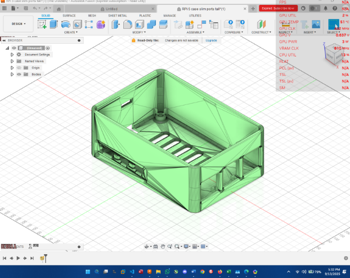
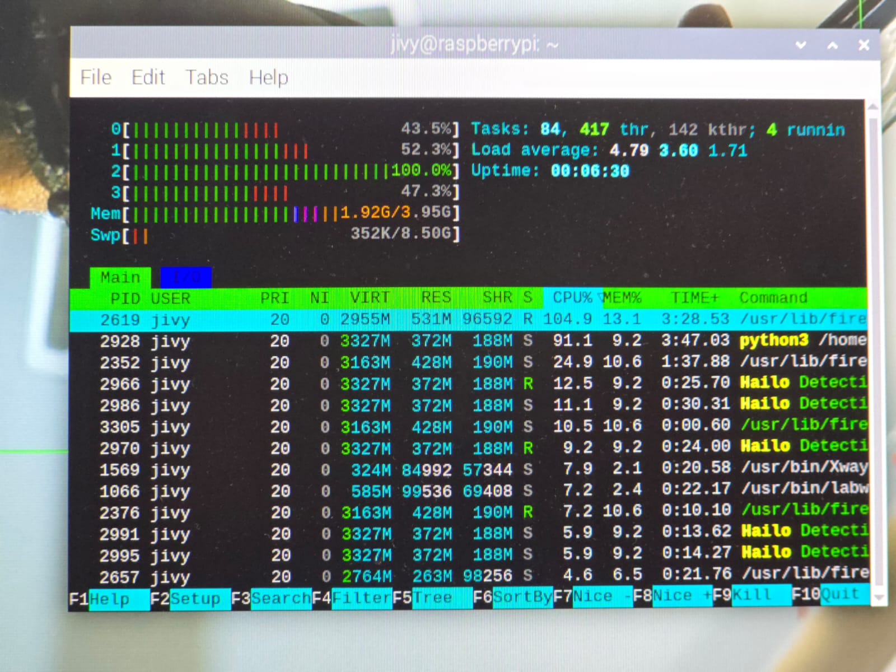
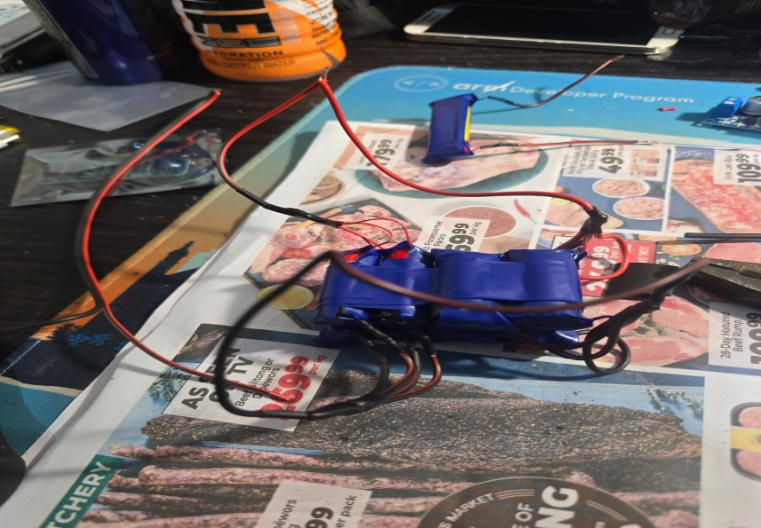

# Hardware and wiring

## Documented prototype components

| Component | Role |
|---|---|
| Raspberry Pi 5, 4 GB | Host computer and application orchestration |
| Hailo AI HAT+ / accelerator | On-device neural-network inference |
| CSI AI camera | Visual input |
| Two active cooling assemblies | Pi and accelerator thermal management |
| Wired audio output | Object and assistant feedback |
| Microphone | Vosk voice commands |
| SG90 servo | Voice-controlled camera rotation |
| ESP32 | Haptic-belt controller |
| Three VL53L0X ToF sensors | Left, centre and right proximity sensing |
| Three or four vibration motors across project iterations | Directional haptic feedback |
| Protected battery system | Portable power |

The reports describe multiple prototype iterations. The repository's primary belt firmware represents the final **three-sensor ESP32/ToF implementation** recovered from the 2026 report. The older four-zone RP2040/ultrasonic code is retained under `firmware/prototypes/`.

## Servo wiring

| Signal | Default |
|---|---:|
| Servo control | GPIO 17 |
| PWM frequency | 50 Hz |
| Minimum logical angle | 0° |
| Maximum logical angle | 180° |
| Centre offset | -10° |

Use a separate, correctly rated 5 V supply for the servo where appropriate, with a shared ground. Servo stall current can cause Raspberry Pi undervoltage or instability.

## ESP32 haptic belt wiring

| Function | Pin |
|---|---:|
| I²C SDA | 21 |
| I²C SCL | 22 |
| Left sensor XSHUT | 14 |
| Centre sensor XSHUT | 27 |
| Right sensor XSHUT | 26 |
| Left motor-driver input | 18 |
| Centre motor-driver input | 19 |
| Right motor-driver input | 23 |

The sensors receive addresses `0x30`, `0x31`, and `0x32` after startup.

## Motor-driver requirement

Vibration motors draw substantially more current than an ESP32 GPIO can safely supply. Each motor output requires an appropriate transistor or logic-level MOSFET stage, gate/base resistor, flyback protection where applicable, and a power source sized for the motor load. Verify common grounding and avoid exposed conductors against the body.

## Enclosure

The project report states that the enclosure was adapted from a Printables design and modified in Fusion 360 to accommodate the Pi and Hailo hardware. The original upstream model link and redistribution licence were not preserved in the supplied source material. For this reason, the repository includes screenshots but does **not** distribute an STL or editable CAD file.

## Cooling

The report describes thermal paste, pads and forced airflow modifications. It reports a later peak Raspberry Pi temperature of approximately 54 °C at approximately 25 °C ambient after cooling improvements, while an earlier limitation section records temperatures above 75 °C before the thermal solution was applied.

## Power system warning

The prototype used reclaimed vape cells in a protected pack. Reclaimed lithium-ion cells can have unknown chemistry, damage, capacity mismatch and internal resistance. This repository does not provide battery-pack construction instructions.

For any reproduction:

- use certified, matched cells or a professionally built pack;
- use a correctly rated BMS, fuse and power converter;
- verify voltage under maximum load;
- provide strain relief, insulation and a physical disconnect;
- do not wear or charge an experimental pack unattended;
- obtain qualified electrical review before human use.

