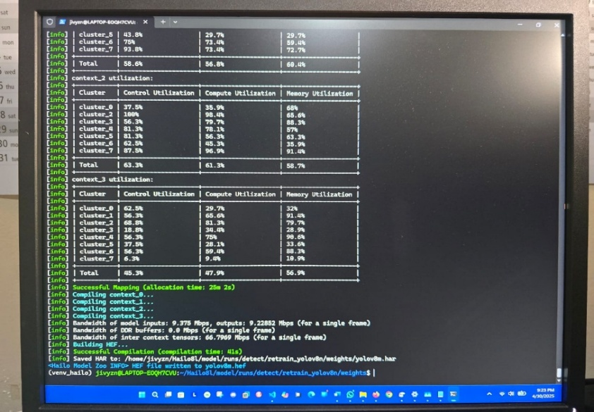

# Model card: `yolov8m.hef`

## Summary

| Field | Value |
|---|---|
| File | `models/yolov8m.hef` |
| Network name visible in binary | `yolov8m` |
| File size | 30,526,867 bytes |
| SHA-256 | `53a92d7db2e43bad67e4426a848767e91981c166f90f9e775caeb5898433a852` |
| Task | Object detection |
| Deployment format | Hailo Executable Format (HEF) |
| Intended host | Raspberry Pi 5 with compatible Hailo accelerator |
| Training family | Ultralytics YOLOv8m, according to project reports |

## Intended use

The model is intended for research demonstrations of offline environmental object identification as one component of an assistive-navigation prototype.

It is **not** intended for:

- clinical diagnosis;
- sole-source collision avoidance;
- autonomous vehicle control;
- safety-critical industrial use;
- face identification or surveillance;
- replacing mobility aids or trained human assistance.

## Training and conversion history

The supplied reports describe a staged progression from YOLOv8n prototypes to a final YOLOv8m model. The final model was reportedly converted through:

```text
PyTorch (.pt) → ONNX → Hailo archive (.har) → quantised HEF
```



## Dataset uncertainty

The reports describe COCO classes and locally captured examples, but the records conflict on total images, class counts and test-set size. The original dataset, exact split manifests, calibration set, YAML and final training logs were not supplied with this repository. The HEF is therefore deployable but not fully reproducible from source data in this release.

See [DATASET.md](DATASET.md).

## Reported results

The author reports an 87% controlled detection rate for the final model and 30–65 FPS on the deployed Pi/Hailo system. These figures are not independently re-measured by this repository release and should not be interpreted as COCO mAP without the missing evaluation artefacts.

## Known limitations

- low light and direct glare;
- reflective or highly patterned backgrounds;
- very close objects producing ambiguous bounding boxes;
- underrepresented local classes;
- unknown post-quantisation per-class metrics;
- runtime compatibility tied to Hailo toolchain versions.

## Licence and redistribution

The model was produced with an Ultralytics YOLO toolchain and compiled with Hailo software. Users are responsible for compliance with applicable Ultralytics, dataset and Hailo terms. See [THIRD_PARTY_NOTICES.md](../THIRD_PARTY_NOTICES.md).
