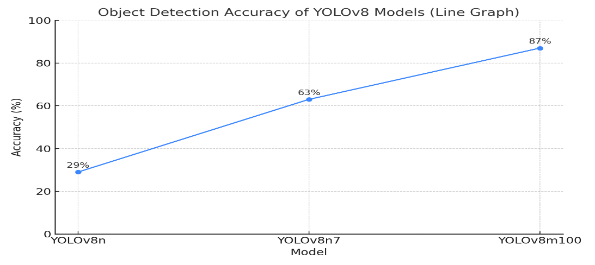

# Performance and evidence statement

## What the project reports

The 2026 report records three controlled model iterations:

| Iteration | Reported result |
|---|---:|
| YOLOv8n | 29% |
| YOLOv8n7 | 63% |
| YOLOv8m100 | 87% |

It also reports:

| System metric | Reported result |
|---|---:|
| Detection-to-feedback latency | ~150 ms |
| Hailo inference throughput | ~30–65 FPS |
| Average Pi CPU utilisation during inference | below 30% |
| Head-unit runtime | ~4 hours |
| Belt runtime under continuous vibration | ~1.5 hours |
| Pi peak temperature after cooling improvements | ~54 °C at ~25 °C ambient |
| Training GPU draw | ~85 W peak |

## Important interpretation limits

These numbers are reproduced from the author's reports and were not independently rerun while preparing this repository.

The source materials differ in several places:

- The older report describes 24/80, 51/80 and 70/80 detections while displaying rounded percentages of 29%, 63% and 87%.
- The newer report describes a 100-target controlled protocol and gives 29/100, 63/100 and 87/100.
- “Accuracy” in the report refers to controlled successful detections, not a fully specified classification accuracy or COCO mAP calculation.
- Training logs, predictions, ground-truth manifests and per-class results were not included in the supplied repository source.

Therefore this repository labels these values **reported controlled detection rates**. They must not be used as a clinical safety claim or directly compared with published mAP values.

## Reproduction plan

A future reproducible benchmark should include:

1. immutable test images and labels;
2. exact class map;
3. model input resolution and preprocessing;
4. confidence and NMS thresholds;
5. precision, recall, mAP@0.50 and mAP@0.50:0.95;
6. per-class confusion matrix;
7. warm-up policy and frame-count definition;
8. end-to-end timestamps covering capture, inference, filtering and audio onset;
9. power and thermal logs with measurement instruments and ambient conditions;
10. HEF/runtime/compiler version information.

## Visual record

